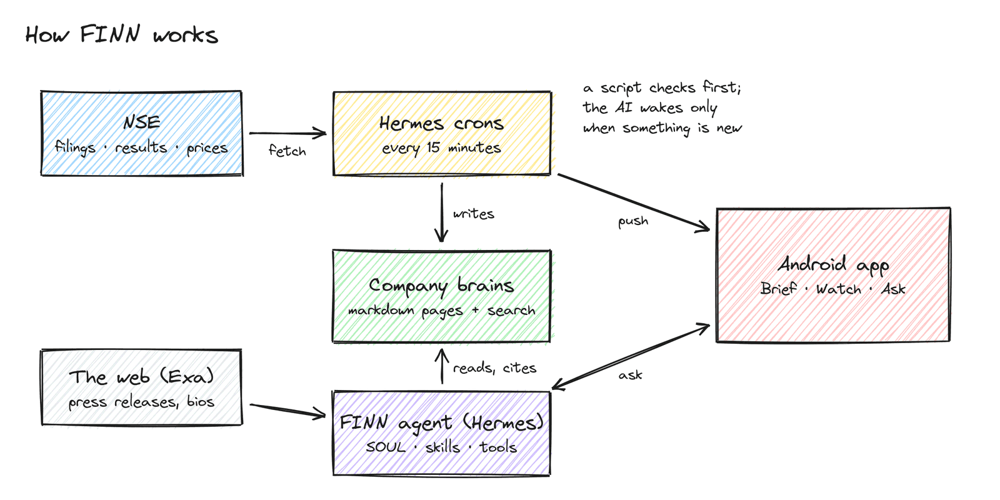
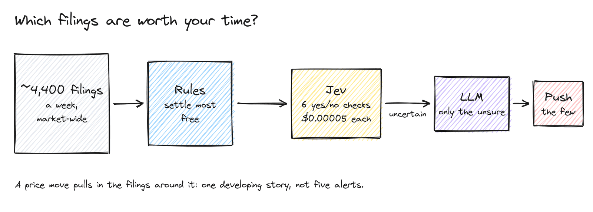
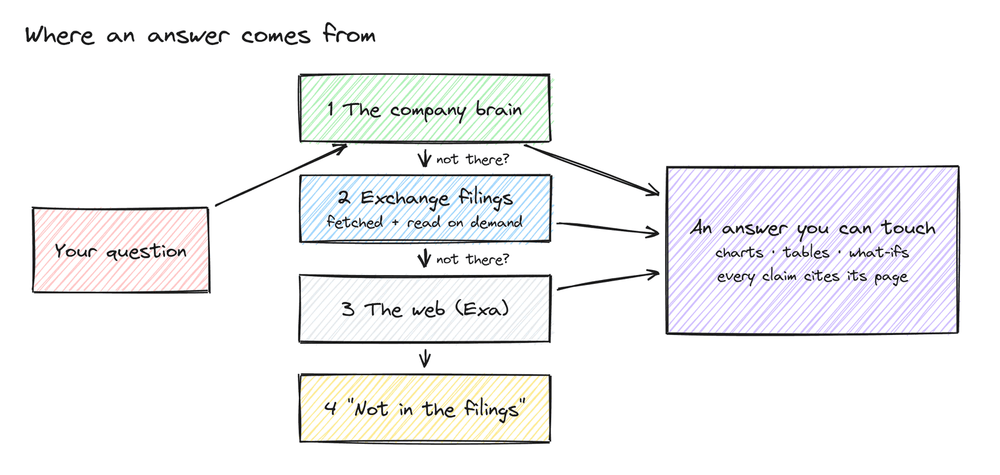
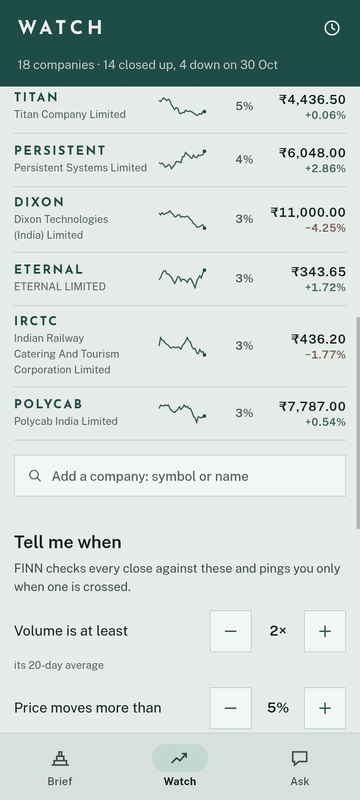

# FINN

An always-on investor agent for NSE portfolios. It reads every exchange filing, keeps the few that matter to you, and answers your questions from the companies' own filings, results and call transcripts, with every claim cited.

https://github.com/user-attachments/assets/4be877ba-b2c9-4b29-872c-dd857aba49d1

<p align="center"><sub>▶ One-minute demo: the real app, answering real questions</sub></p>
<p align="center">
  <b><a href="../../releases/latest">Download the app</a></b> ·
  <a href="docs/COVERING_NOTE.md">Covering note</a> ·
  <a href="DESIGN.md">Design</a> ·
  <a href="docs/build-history/">AI build history</a>
</p>

## Try it

1. Install `FINN.apk` from the [latest release](../../releases/latest) on an Android phone.
2. Take the short tour, then unlock with the password you were given.
3. Ask something:
   - *"What if L&T's order inflow grows 5–25% next year?"*
   - *"Compare TCS, Infosys and Persistent on their latest quarter."*
   - *"Every weekday at 8:30, brief me on my IT stocks."*

## How it works



FINN runs on [Hermes](https://github.com/NousResearch/hermes-agent). **Push** is Hermes's scheduler: every 15 minutes a script pulls NSE's filings, and the AI wakes only when something new needs judgment. **Pull** is the agent itself, with FINN's tools. Both read and write the same per-company **brain**, a folder of plain markdown pages with full-text search.



Deciding what matters is a cascade where each stage is cheaper than the next: rules first, then TypeSafe Jev's six yes/no checks, then an LLM only for the filings still in doubt.



Answers follow a fixed lookup order and come back as native, tappable blocks: charts, tables, timelines and what-if tools.

## See it

<table>
<tr>
<td width="50%" align="center"><br><sub><b>What-ifs you can drag</b>, built from filed numbers</sub></td>
<td width="50%" align="center"><br><sub><b>Tables and charts</b> straight from NSE XBRL</sub></td>
</tr>
<tr>
<td align="center"><br><sub><b>Every claim cites its page</b>: tap to read it</sub></td>
<td align="center"><br><sub><b>Timelines</b> from the exchange's own filings</sub></td>
</tr>
<tr>
<td align="center"><br><sub><b>What changed</b>, as a deck you flick</sub></td>
<td align="center"><br><sub><b>The company brain</b>, searchable as you type</sub></td>
</tr>
<tr>
<td align="center"><br><sub><b>Watches</b>: scheduled jobs and every answer they sent</sub></td>
<td align="center"><br><sub><b>Add any NSE company</b> by symbol or name</sub></td>
</tr>
</table>

### Screens

<sub>Scroll sideways →</sub>

<table>
<tr>
<td align="center"><br><sub>Data-centre exposure as cards</sub></td>
<td align="center"><br><sub>IT results: table and chart</sub></td>
<td align="center"><br><sub>eMudhra's October, dated</sub></td>
<td align="center"><br><sub>L&T what-if</sub></td>
<td align="center"><br><sub>L&T promised vs delivered</sub></td>
<td align="center"><br><sub>Company: price and its brain</sub></td>
<td align="center"><br><sub>L&T's brain</sub></td>
<td align="center"><br><sub>Holdings</sub></td>
<td align="center"><br><sub>A watch and its runs</sub></td>
<td align="center"><br><sub>The Brief</sub></td>
<td align="center"><br><sub>The tour</sub></td>
</tr>
</table>

## Repo map

| Path | What |
|---|---|
| `api/` | FastAPI service: NSE sources, materiality, ingest, brains, research, chat, push |
| `hermes/` | The agent: `SOUL.md`, skills, FINN tools, the app's platform adapter, cron scripts |
| `app/` | The Android app (Expo / React Native) |
| `deploy/oci.sh` | Deploy to two Oracle Cloud VMs |
| `scripts/` | Versioned releases, build-history export |

## Run it yourself

```bash
cd api && uv sync && uv run uvicorn finn_api.main:app --port 8000   # API
bash hermes/provision.sh && hermes-finn gateway run                  # agent + crons
cd app && npm install && npx expo start                              # app
```

Keys go in `.env` (never committed): `FINN_JWT_SECRET`, `FIREWORKS_API_KEY`, `TYPESAFE_API_KEY`, `DATALAB_API_KEY`, `EXA_API_KEY`, `SMALLEST_API_KEY`, `FINN_FCM_CREDENTIALS`. Set the app password with `uv run finn password`. Tests: `cd api && uv run pytest`.
