# FINN

An always-on investor agent for NSE portfolios. It reads every exchange filing, keeps the few that matter, writes one line on why, and lets you ask follow-up questions that are answered only from the company's own filings, results and call transcripts.

- **Covering note:** [docs/COVERING_NOTE.md](docs/COVERING_NOTE.md)
- **AI build history:** [docs/build-history/](docs/build-history/), the cleaned Claude Code session in which this was built

<p align="center">
  
  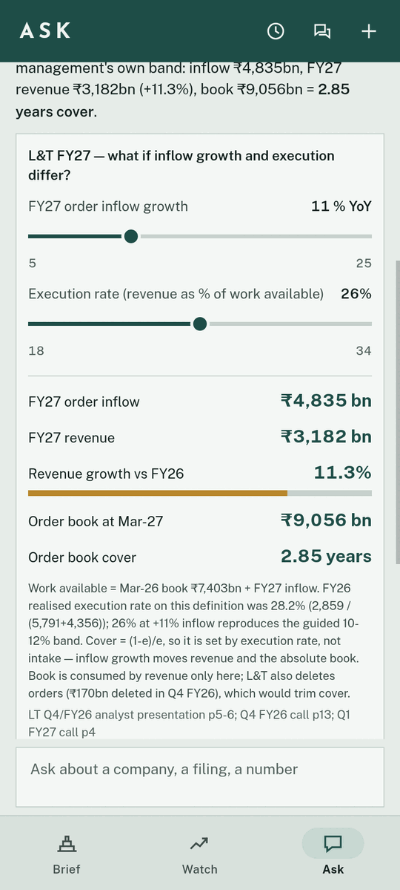
  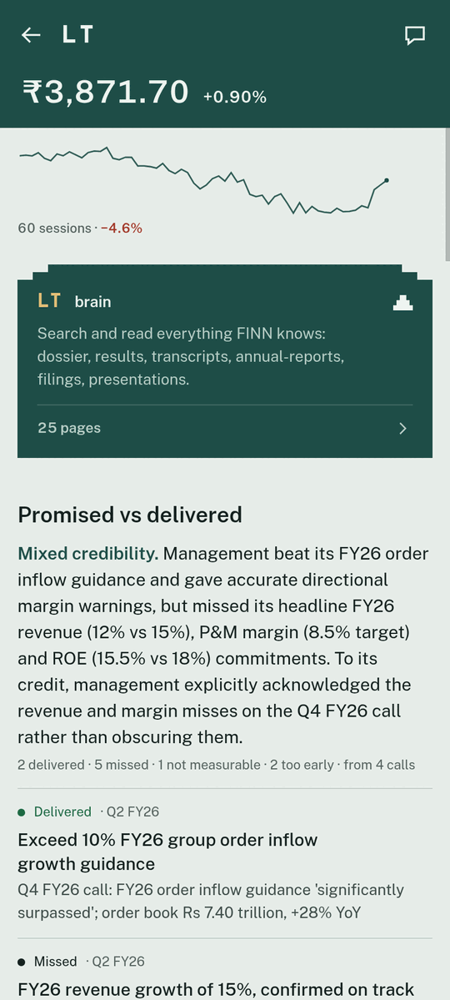
</p>

## Try it

1. Download **`FINN.apk`** from the latest [GitHub release](../../releases) on an Android phone and install it. Allow installs from your browser when Android asks.
2. Open it. A short tour shows what FINN does (answer blocks, sources, scheduled watches); allow notifications on its last page to get pushes for material filings and unusual moves.
3. Enter the password you were given. The server checks it and issues a 30-day session for this phone (`https://129-225-119-60.sslip.io/api`); no key is built into the app. Changing the password on the server signs every phone out.

Worth trying:
- **Brief → 7d:** ranked stories (lead story, results cards, management change with a bio).
- **Tap a story:** why FINN surfaced it, and what the exchange says.
- **Watch:** tap a company, then "Promised vs delivered", the business, trajectory and bull/bear.
- **Brief:** flick through the "Needs you" deck; filter any section.
- **Watches (clock icon on Watch or Ask):** every scheduled job, its next run and every answer it has delivered; pause, run now or delete. "New watch" sets one up through FINN. A watch's notification opens its page.
- **Watch → a company → its brain:** search "attrition" or "order book" across annual reports and transcripts.
- **Ask:**
  - "How did TCS do last quarter?"
  - "What did Maruti's latest results show?"
  - "Every weekday at 8:30, send me a two-line brief on my IT stocks." This creates a real scheduled job.
  - "Compare Maruti's October 2019 sales with October 2026 and chart it." FINN fetches 2019 from NSE and replies with a native chart.
- **Speak:** ask by voice; tap **Listen** on any answer.

## See it

Everything below is the real app talking to the live backend. The answers are FINN's own replies to the questions shown, built from the companies' filings, with no hand-made examples.

### Answers you can touch

FINN answers in blocks the app draws natively: charts, sortable tables, timelines, cards and what-if tools, with every claim a tap-to-source citation.

<table>
<tr>
<td width="50%" align="center">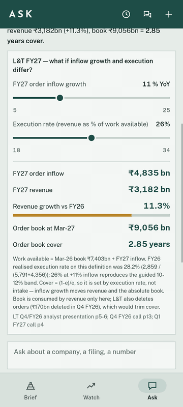<br><sub><b>"What if L&T's order inflow grows 5–25% next year?"</b><br>FINN builds a what-if from L&T's filed FY26 numbers. Drag the sliders and FY27 revenue, the order book and years of cover recompute in the app. The default settings reproduce management's own guided band.</sub></td>
<td width="50%" align="center">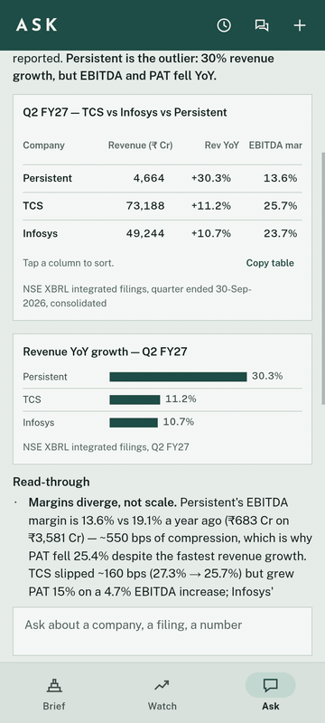<br><sub><b>"Compare TCS, Infosys and Persistent on their latest quarter."</b><br>A sortable table and a chart straight from the NSE XBRL filings. Tap a column to re-rank, tap a bar to read it.</sub></td>
</tr>
<tr>
<td align="center">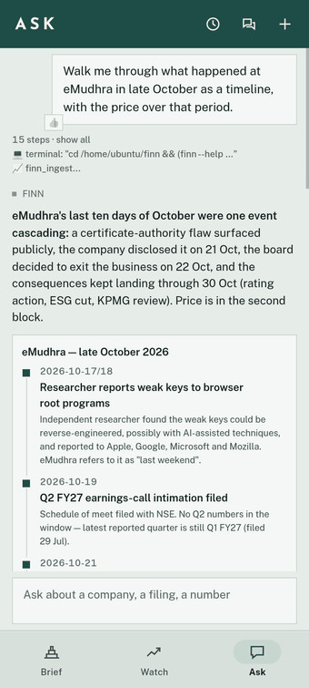<br><sub><b>"Walk me through what happened at eMudhra in late October."</b><br>A dated timeline from the exchange filings (weak keys, the exit from the TLS business, the ICRA review, the ESG cut, the KPMG review), then a live price block: −37.5%.</sub></td>
<td align="center">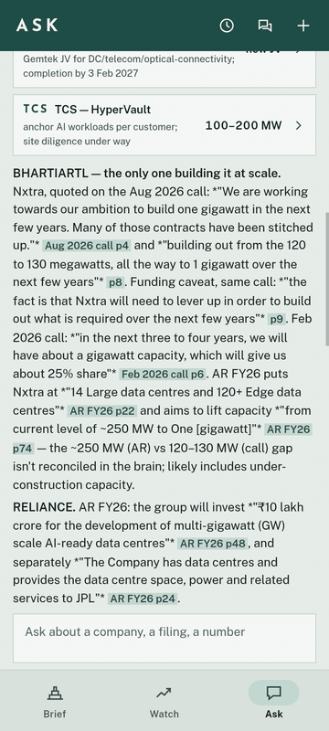<br><sub><b>"Which of my companies talk about data centres?"</b><br>Company cards with 18 citations. Tap one and the exact page slides up: here, Bharti Airtel's Q1 call, page 4.</sub></td>
</tr>
<tr>
<td align="center">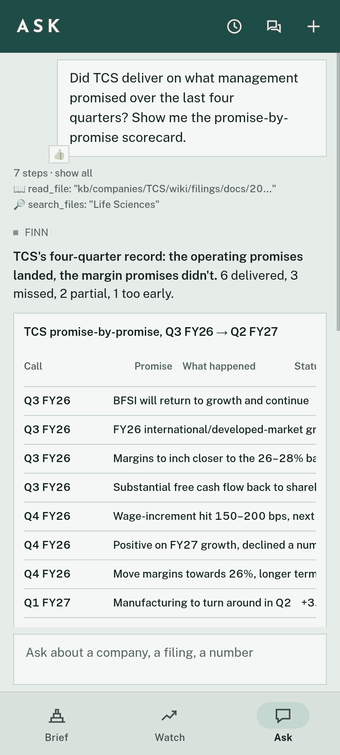<br><sub><b>"Did TCS deliver on what management promised?"</b><br>A promise-by-promise scorecard across four calls: each promise quoted, checked against the next quarter's filing and call, and cited.</sub></td>
<td align="center"><br><sub><b>The brain.</b> Every company's filings, results, transcripts and annual reports as linked pages. SQLite FTS5 search finds "order book" across all of them as you type, and opens the page at the hit.</sub></td>
</tr>
</table>

### Push: what changed, ranked

<table>
<tr>
<td width="50%" align="center">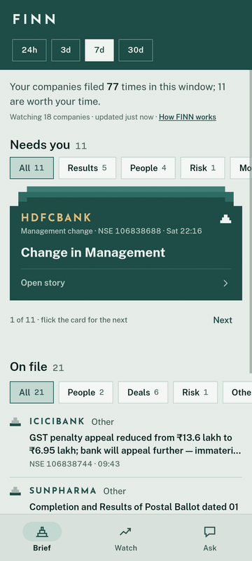<br><sub><b>Needs you.</b> The material stories as a deck you flick through, each ranked with the setback mark and carrying the exchange's own reference. Filters per section.</sub></td>
<td width="50%" align="center">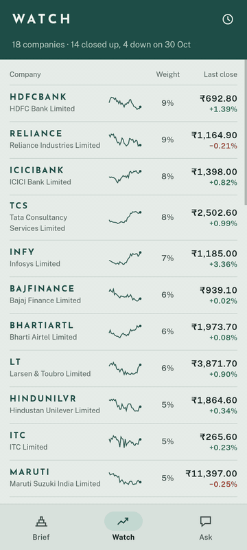<br><sub><b>Watches.</b> "Every weekday at 8:30, brief me on my IT stocks" in chat becomes a real Hermes cron. Every job, its next run and every answer it has delivered, in one place. Its notification opens here.</sub></td>
</tr>
</table>

### Screens

<p align="center">
  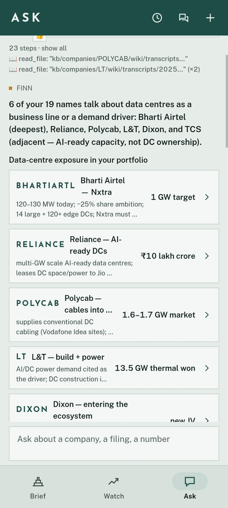
  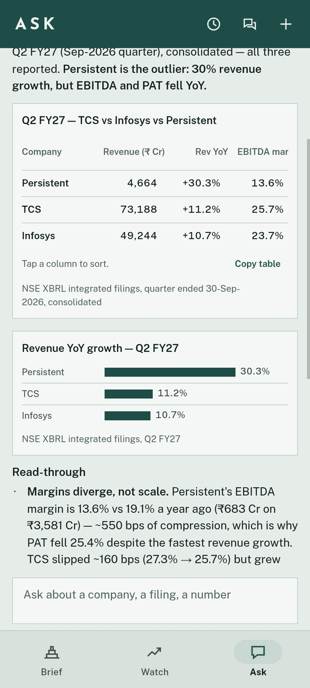
  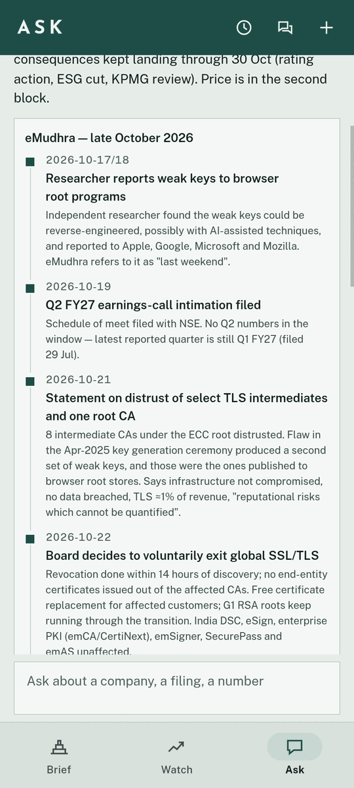
  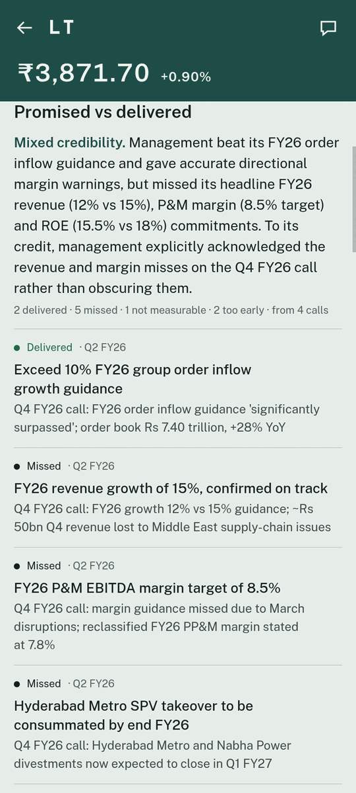
</p>
<p align="center">
  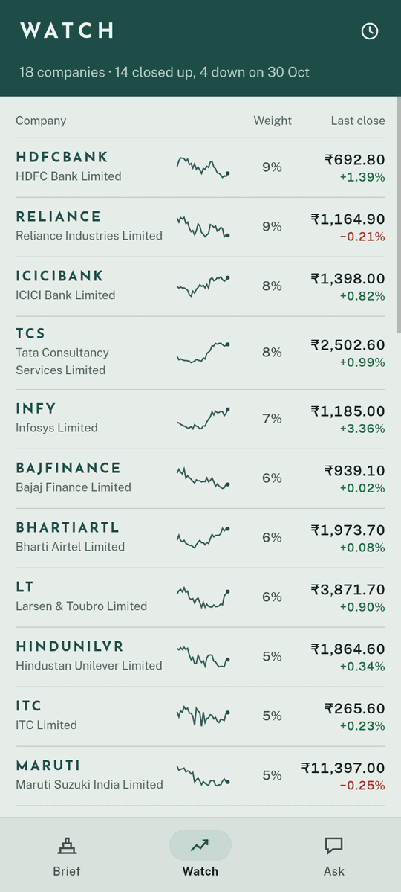
  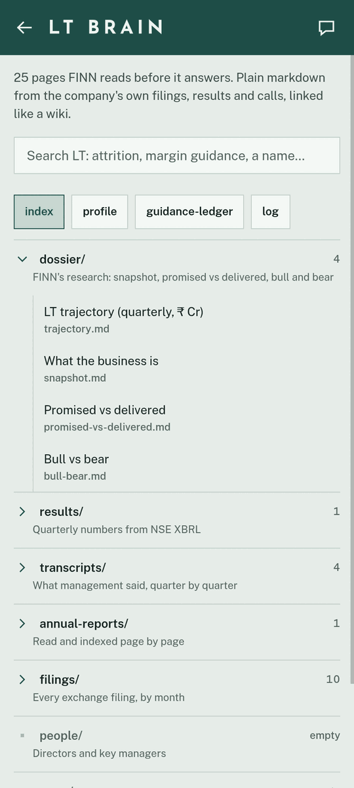
  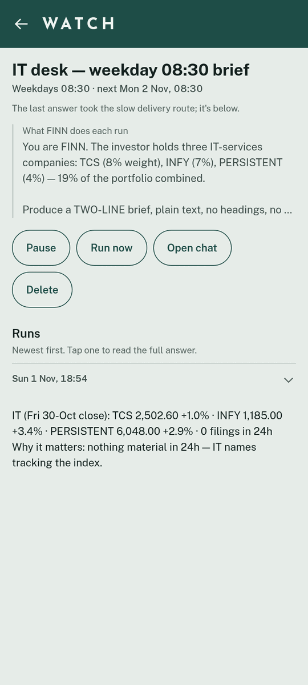
  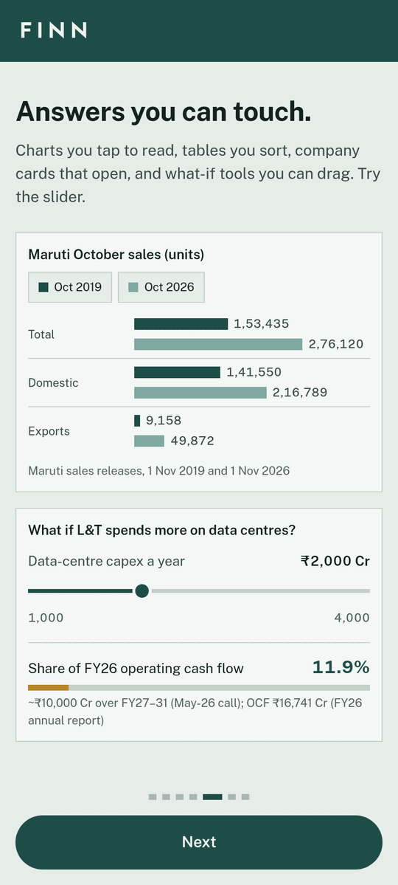
</p>
<p align="center"><sub>Left to right: data-centre exposure as cards · IT results as a table and chart · eMudhra's timeline · L&T promised vs delivered · holdings · L&T's brain · a watch and its runs · the tour</sub></p>

## How it works

```
Android app (Expo / React Native)
  │  HTTPS + JWT
  ▼
Caddy edge (OCI, public)  ──►  FINN API (FastAPI, SQLite)          worker (OCI, private)
                                 ├─ digest, stories, holdings, thresholds
                                 ├─ company brains + dossiers
                                 ├─ conversations ⇄ Hermes `finn_app` platform plugin
                                 └─ FCM push
                               Hermes gateway (`finn` profile)
                                 ├─ finn_app adapter: the app is a chat platform like Telegram
                                 ├─ tools: finn_digest / results / dossier / filing_text / enrich
                                 ├─ Mem0 memory, smallest.ai STT/TTS, Exa people search
                                 └─ crons (script-gated; wake the agent only when needed):
                                      announcements (15 min) · ingest (15 min) · EOD 18:30 IST
```

**Data sources:**
- NSE corporate announcements, integrated-filing XBRL results and the daily bhavcopy.
- Screener's document links to annual reports and concall transcripts, hosted on BSE and company IR sites.
- Exa, for executive bios only.

**Models:**
- Rules, then TypeSafe **Jev** (typed yes/no screening), then Fireworks **GLM-5.3-Flash** (reading and one-liners, low reasoning effort), then **Kimi-K3** (promised vs delivered, bull/bear).
- **Chandra** OCR (via Datalab) only for slide- and table-heavy PDFs.
- **PageIndex** for annual-report trees (no LLM).

**Company brains:** `kb/companies/{SYMBOL}/wiki/` is plain markdown with no embeddings. It holds filings, results, transcripts, annual reports with PageIndex trees, people, the guidance ledger and the dossier. The agent and the app read the same files.

## Repo map

| Path | What |
|---|---|
| `api/src/finn_api/` | API, NSE sources (`sources/`), materiality cascade, ingest, research, conversations, FCM |
| `hermes/` | Hermes profile: `SOUL.md`, skills, `plugins/finn` (tools), `plugins/finn_app` (platform adapter), cron scripts, `provision.sh` |
| `app/` | Expo app (Brief, Watch, Ask, story, company/dossier) |
| `deploy/oci.sh` | Two-VM deploy: Caddy edge + worker (API, Hermes, crons) |
| `research/materiality/` | Market-reaction labels for a learned materiality model (not finished) |
| `scripts/export_build_history.py` | Produces the cleaned, redacted build history |

## Run it yourself

```bash
# API
cd api && uv sync && uv run finn onboard TCS INFY HDFCBANK && uv run uvicorn finn_api.main:app --port 8000
uv run finn dossier TCS            # annual report + 4 transcripts → dossier
uv run finn cron announcements     # one push-side tick

# Hermes profile (needs a local hermes-agent checkout)
bash hermes/provision.sh && hermes-finn gateway run

# App
cd app && npm install && npx expo start
```

Keys go in `.env` (never committed): `FINN_JWT_SECRET`, `FIREWORKS_API_KEY`, `TYPESAFE_API_KEY`, `DATALAB_API_KEY`, `EXA_API_KEY`, `SMALLEST_API_KEY`, `MEM0_API_KEY`, `FINN_FCM_CREDENTIALS`.

Tests: `cd api && uv run pytest`. They run against real NSE fixtures (XBRL for TCS and HDFC Bank, a week of announcements, a bhavcopy).
